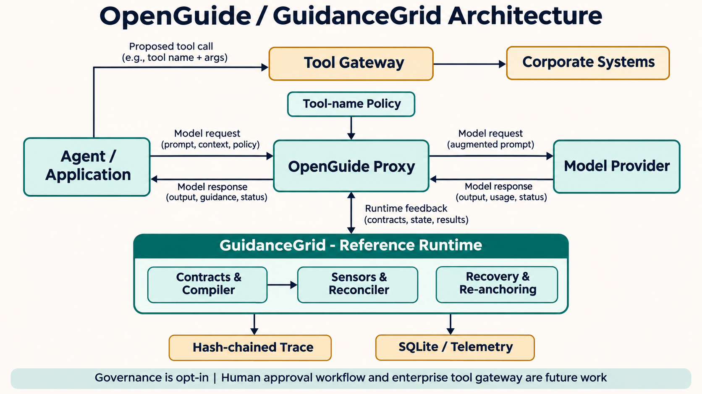
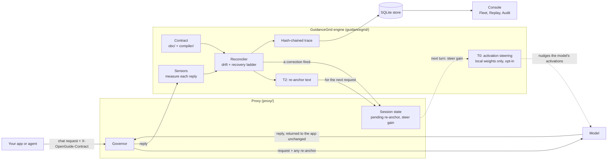
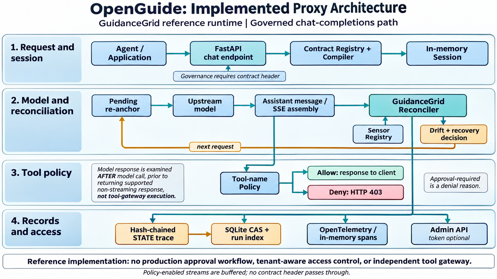
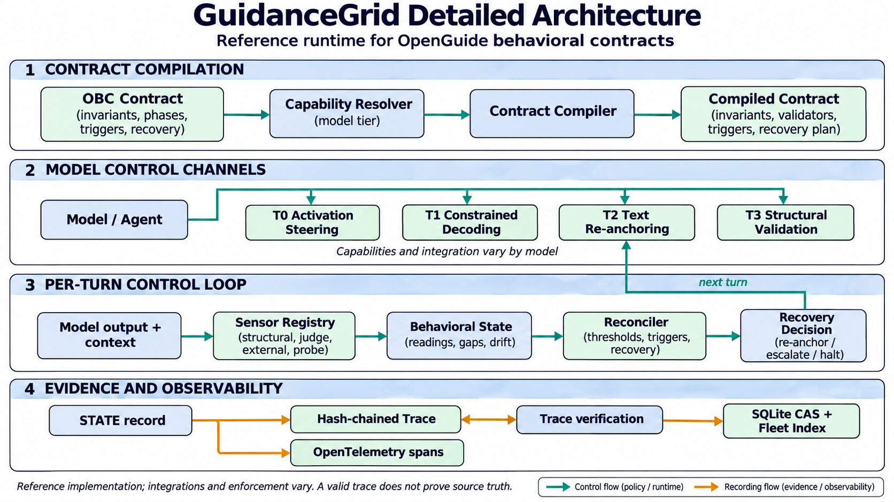
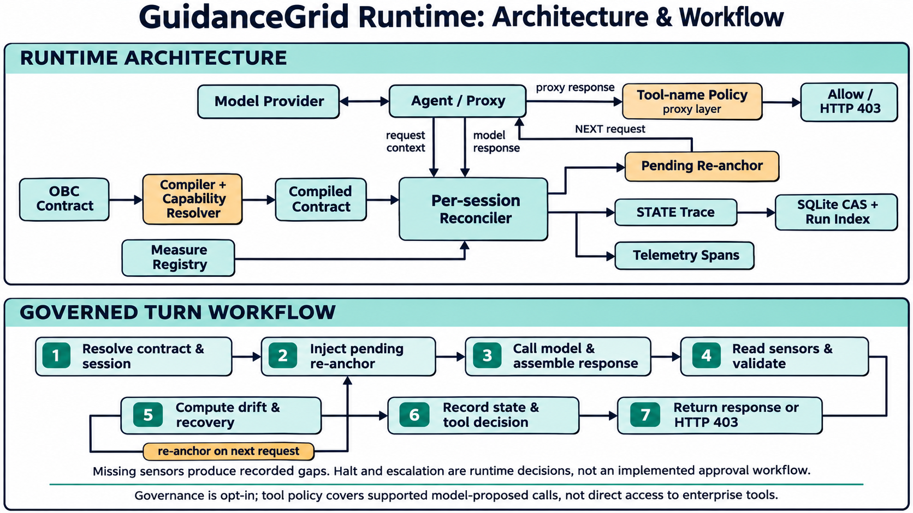

<p align="center">
  
</p>

# A behavioral control plane for AI agents.

[](https://github.com/maheshvaikri-code/openguide/actions/workflows/ci.yml)
[](pyproject.toml)
[](pyproject.toml)
[](#evidence-and-roadmap)


OpenGuide explores how teams can define expected agent behavior, monitor it over
time, and record the resulting decisions. Its reference runtime, **GuidanceGrid**,
compiles behavioral contracts for different model capabilities. An
OpenAI-compatible proxy brings these controls to chat-based workflows.

[Get started](#get-started) | [How it works](#how-it-works) | [Corporate demos](#corporate-demos) | [Evidence and roadmap](#evidence-and-roadmap) | [Documentation](#documentation)

> **Project status:** Research and reference implementation, not a complete
> enterprise security gateway. Benchmarks are simulated, and the corporate
> demos use real public data with scripted agents and simulated tool calls.

## Why OpenGuide?

AI agents increasingly make decisions across long workflows and propose actions
in business systems. Teams need to understand whether an agent is staying within
its intended boundaries, what happened when it drifted, and which actions were
allowed or blocked.

OpenGuide combines three ideas in one project:

- **Behavior as a contract:** Declare invariants, phases, triggers, and recovery
  actions in an Open Behavioral Contract (OBC).
- **A feedback loop:** Measure behavioral signals, detect drift, and generate
  a re-anchor or other recovery decision as the workflow progresses.
- **Reviewable evidence:** Record runtime state and supported tool-policy
  decisions in a hash-chained trace that can be verified and inspected.

For AI platform, security, and risk teams, the opportunity is to connect
behavioral observability with runtime control. For developers, the repository
provides an executable runtime, a proxy, contracts, examples, and test fixtures
to explore that approach.

## How it works



1. Register or load an OBC contract describing expected behavior.
2. Send a request to the proxy with `X-OpenGuide-Contract` and, for continuity,
   `X-OpenGuide-Session`.
3. The runtime measures the response, records behavioral state, and can prepare
   re-anchoring text for a later turn.
4. For governed requests, an optional proxy policy can allow or deny supported
   model-proposed tool calls by name. Decisions are recorded in the trace.

The application or a separate tool gateway remains responsible for executing
and authorizing actions against corporate systems. Governance is opt-in: requests
without a contract header pass through the proxy without these controls. The
proxy does not enforce actions that bypass it. See [enterprise governance](docs/enterprise-governance-layer.md)
for the trust boundary and outstanding work.

### How the pieces fit

Three layers, each with one job. The **Console** only displays. The **proxy** carries traffic and calls the engine
after every reply. **GuidanceGrid** is the engine that does the measuring, deciding and recording.



Reading it, for one turn: the app sends a request; the proxy forwards it (with a re-anchor reminder if the last turn
needed one) and returns the model's reply unchanged; the engine scores that reply against the contract, decides
whether to correct, and records the result; the next turn carries the correction. **T0 steering** is the dotted
path: if the proxy owns the model's weights and a steering pack is configured (in code today; there is no command-line
switch yet), the turn *after* a correction is also steered at a small gain ([ADR-003](docs/adr/003-drift-gated-t0-in-the-proxy.md)). Hosted APIs cannot be
steered, so they use T2/T3 only.

### Implemented proxy architecture



**At a glance:** The proxy connects an application to a model, runs the
GuidanceGrid reconciler on supported governed responses, and can return an
allowed response or an HTTP 403 for a denied tool call.

- **Request and session:** A contract header selects governance. The proxy
  resolves the contract and maintains in-memory state for the session.
- **Model and reconciliation:** The proxy forwards the request, assembles the
  assistant message, and records drift and recovery decisions. A pending
  re-anchor can be added to a subsequent request in the same session.
- **Tool policy:** Supported model-proposed tool names can be allowed or
  denied. `approval_required` is a denial reason, not a human approval queue.
- **Records and access:** Trace snapshots and the run index can be stored in
  SQLite; telemetry is emitted separately. Admin-token protection is optional.

**Enterprise significance:** This is a foundation for observing agent
behavior and filtering supported proposed calls. An independent tool gateway,
enterprise access controls, and a real approval process are still needed.
Requests without a contract header pass through without governance; when a
tool policy is enabled, streaming responses are buffered for inspection.

### GuidanceGrid runtime components



**At a glance:** GuidanceGrid turns a behavioral contract into runtime
configuration, measures behavior against it, and records what the controller
observed and decided.

- **Contract compilation:** The OBC contract describes invariants, phases,
  triggers, and recovery. The compiler and capability resolver produce a
  contract configuration for the target model and available tier.
- **Control channels:** T0 activation steering, T1 constrained decoding, T2
  text re-anchoring, and T3 structural validation are reference components.
  Their availability and integration depend on the model and deployment;
  the diagram does not imply that all four run together in the proxy.
- **Per-turn control:** Registered sensors supply readings or report gaps. The
  reconciler calculates drift, evaluates validation results and triggers, and
  selects a recovery decision when configured thresholds are met.
- **Evidence:** Behavioral state is appended to a hash-chained trace. The
  proxy can persist trace snapshots and run metadata, and emit telemetry.

**Enterprise significance:** Contracts and traceable runtime decisions offer a
common way to examine agent behavior across workflows. A verified trace can
detect changes to the chain, but does not establish that the source data or
sensor judgments are correct.

### Runtime workflow for one governed turn



**At a glance:** Each governed turn moves through a repeatable loop from
contract selection to an observable decision. The proxy implementation is in
[`proxy/governance.py`](proxy/governance.py); the runtime reconciliation is in
[`guidancegrid/controller/reconciler.py`](guidancegrid/controller/reconciler.py).

1. **Resolve:** Look up the contract and use the supplied session ID, or create
   a generated session ID when none is provided.
2. **Prepare:** Add any pending re-anchor from the prior turn to the request.
3. **Call:** Forward the request to the model and assemble the response for
   analysis. Streaming behavior depends on whether tool policy is enabled.
4. **Measure:** Read registered sensors and run structural validation. Missing
   sensors are recorded as gaps rather than treated as successful readings.
5. **Reconcile:** Calculate drift, evaluate triggers, and determine any
   configured recovery decision. Re-anchor text can feed the next turn.
6. **Record:** Append behavioral state and, for proposed tool calls, the
   proxy's tool-policy decision to the trace. Persist snapshots when a store is
   configured and emit telemetry through the configured emitter.
7. **Respond:** Return an allowed response or, for a supported denied tool
   call, HTTP 403. Halt and escalation are runtime decisions; they do not
   themselves provide an enforced stop or an approval workflow.

**Enterprise significance:** The loop links declared expectations,
measurements, recovery decisions, and action-policy outcomes. That evidence
can support investigation, but it is not a substitute for system-level access
controls or compliance certification.

## Get started

**Prerequisites:** Python 3.10 or later. The proxy quickstart uses FastAPI and
HTTPX; the development extra also installs the test and lint tools.

From the repository root:

```bash
python -m pip install -e ".[dev,obc]"
python examples/quickstart-proxy/run.py
```

The offline quickstart uses a mock upstream and scripted sensor readings. It
prints per-turn drift and recovery decisions, followed by a trace verification
result. It requires no API key or GPU.

Run the tests and conformance checks:

```bash
python -m pytest
python -m ruff check .
python spec/conformance/run_conformance.py
```

For a locally hosted proxy and Jaeger, see the
[Docker Compose guide](deploy/compose/README.md). Its SQLite volume persists
the fleet index and content-addressed trace snapshots; PostgreSQL is not yet a
supported proxy backend.

### Use a contract

Contracts are TOML files with a reproducible content hash:

```python
from guidancegrid.obc import contract_hash, load_contract, validate_contract

contract = load_contract("spec/obc/examples/coding-agent-default.toml")
validate_contract(contract)
print(contract_hash(contract))
```

Explore the [contract specification](spec/obc/) and its
[examples](spec/obc/examples/) for the available fields.

## Corporate demos

These reference scenarios use public internet data and a scripted agent. They
do not connect to a real CRM, ERP, SIEM, or EDR system.

| Scenario | Live data source | Scripted action decisions | Run |
| --- | --- | --- | --- |
| Finance and risk | SEC EDGAR company facts | Allow a CRM note; deny an ERP risk update as approval-required | `python examples/corporate-edgar/run.py --refresh` |
| Security operations | CISA Known Exploited Vulnerabilities catalog | Allow a SIEM case; deny host isolation as approval-required | `python examples/cyber-kev/run.py --refresh` |

Both demos require the development dependencies above and internet access for a
fresh data fetch. Set `SEC_USER_AGENT` to an identifying organization and
contact when using the SEC demo. They can also be run through `make
corporate-demo` and `make cyber-demo` where Make is available.

The `approval_required` outcome is currently a **deny reason**, not an
implemented human approval queue or a mechanism to resume an approved action.
The demos show policy and trace mechanics, not model quality or production
security outcomes.

## Capabilities and boundaries

| Area | Available in this repository | Important boundary |
| --- | --- | --- |
| Contracts and runtime | OBC validation, capability resolution, sensors, drift reconciliation, and recovery decisions | Sensor coverage and recovery effectiveness depend on the deployment and measures supplied. |
| Proxy | OpenAI-compatible chat-completions proxy with opt-in governance and streaming support | Not every provider or response shape is covered; validate integrations before use. |
| Tool policy | Name-pattern allowlist, denylist, and approval-required denial for supported governed responses | No identity-aware or argument-aware authorization, real approval flow, or enforcement at the corporate tool itself. Policy-enabled streaming is buffered. |
| Trace and telemetry | Hash-chained records, verification, SQLite-backed snapshots, and OpenTelemetry integration | A valid hash chain does not prove source data is correct or provide immutable, signed, independently anchored storage. |
| Access and privacy | Optional admin token and metadata-only trace response | Enterprise identity, RBAC, tenant isolation, redaction, retention, and production secrets management remain open work. |
| Model control | T2 text re-anchoring and T3 validation in the proxy; opt-in drift-gated T0 activation steering for a model whose weights the proxy runs itself ([docs](docs/t0-steering.md)); T1 as a reference component | T0 cannot steer hosted APIs and was tested on one small model (Qwen2.5-1.5B, 5 conversations; see `benchmarks/REPORT.md` 7.3). Tier fidelity varies by model; capability retention was measured only at one gain on that model. |

OpenGuide does not guarantee model behavior or compliance. Deployment requires
security review, independently enforced tool permissions, and testing against
the intended models and workflows.

## Evidence and roadmap

The project has a working contract/runtime/proxy foundation, conformance
vectors, offline tests, and two public-data corporate reference scenarios.
The [benchmark report](benchmarks/REPORT.md) describes simulated comparisons
and their limitations. Results from real enterprise workloads and real-model
capability-retention tests are still needed.

The next milestones for enterprise evaluation include authenticated identities
and tenant isolation, policy approval workflows, production storage, a tool
gateway, privacy and retention controls, immutable or externally anchored
evidence, and realistic model and workflow evaluations. These are goals, not
claims of completed product functionality. See the
[enterprise capabilities assessment](docs/enterprise-capabilities.md) and
[governance roadmap](docs/enterprise-governance-layer.md).

## Documentation

| Path | Contents |
| --- | --- |
| [spec/](spec/) | Behavioral contract, state and trace specifications, examples, and conformance vectors. |
| [guidancegrid/](guidancegrid/) | Reference runtime, compiler, sensors, control channels, and SQLite store. |
| [proxy/](proxy/) | OpenAI-compatible proxy and tool-name policy. |
| [integrations/](integrations/) | OpenAI SDK, LiteLLM, and LangGraph integration examples. |
| [examples/](examples/) | Offline quickstart, simulated scenarios, and corporate reference demos. |
| [benchmarks/REPORT.md](benchmarks/REPORT.md) | Simulated results (sections 1-6), a small real-model study (section 7), methodology, and threats to validity. |
| [docs/t0-steering.md](docs/t0-steering.md) | Drift-gated activation steering in the proxy: what, why, where, how to turn it on, and its limits. |
| [docs/blueprint.md](docs/blueprint.md) | Architecture, rationale, and phased project plan. |
| [packs/README.md](packs/README.md) | Signal packs and pending real-model evaluations. |

## License

The project declares the Apache License 2.0 in [pyproject.toml](pyproject.toml).
